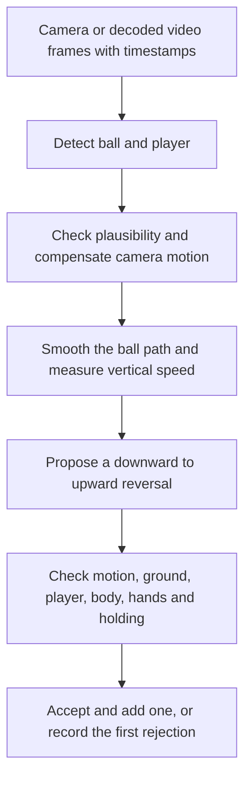

# Current touch counting strategy and gaps

Reviewed against the working tree on `codex/ball-detection-enhancement`, 2026-10-17.

A counted touch is a detected ball moving down and then up near the player, with
enough supporting evidence to pass the ground, body, hand and holding checks.
The ball model finds objects; Apple Vision estimates body landmarks; our Swift
rules decide whether the proposed contact adds one to the counter.

The structure is useful: motion proposes a contact, and independent evidence
checks it. The main remaining weaknesses are inconsistent time windows,
ambiguous 2D body geometry, and incomplete measurement of missed and false touches.

## What the current number means

- It is the total number of accepted contacts in the session. Rejected contacts
  and tracking breaks do not erase earlier accepted touches.
- Feet, knees and head have explicit eligibility paths. Chest contacts can qualify
  through visible hand and arm clearance. Chest is no longer globally disabled.
- Inside and outside feet use the same rules. There is no separate model or reliable
  label identifying which surface of the foot touched the ball.
- A touch record contains time, position and motion measurements. It does not
  establish the anatomical contact type or prove physical contact in 3D.
- This total is not yet a verified, uninterrupted leaderboard streak.

The working-tree body policy is `raisedFootV14`. It retains V13's leg rebound checks, V12's independent leg eligibility and V11's bounded
observed-foot recovery across a detector gap and lets positive leg evidence
qualify independently of which arm-clearance check failed. Completed-rise
confirmation and short falling-arc continuity are enabled in `CounterConfig`, with `corroboratedFeet` ground checks
(`counter-v9`) and `sustainedGripV1` holding checks. Live and imported counting use
the same policy through [ContactCounterFactory](../kicklab/Counting/ContactCounterFactory.swift)
and [CountingPolicy](../kicklab/Counting/CountingPolicy.swift).

## V14: ordinary foot contacts and an occluded player

The five-minute walk-through recording exposed two separate problems. A raised
inside foot sometimes lost its ankle landmark at impact even though the leg was
visible before and afterward. Separately, a person walking past shortened the
selected player's body box, moving the person-box floor proxy upward.

[RaisedFootReboundRules](../kicklab/Counting/RaisedFootReboundRules.swift) uses
already buffered observations within 201 ms of the candidate. It requires a ball
rebound, a moving raised leg, reliable ankle observations before and afterward,
and a stable opposite hip/knee. A weak impact ankle can be corroborated by that
motion; a missing/weak ankle can use a bounded hip-relative bridge between the
observations. A confident contradictory ankle cannot be replaced. This only
establishes eligibility: the normal hand, holding and floor vetoes still run.
No additional model, image cache, or per-frame pose pass is introduced.

The observed-leg path also admits a lower foot when both the foot and lower ball
edge remain at least 0.2 ball diameters above the supporting ankle, with the
existing approach, release and moving-foot checks. Weak *context* detections can
be omitted when another strong, time-bounded trio exists; the candidate itself
is never silently removed or assigned a higher score. The arm-clearance timing
and chest rules remain unchanged.

[PlayerGroundEstimate](../kicklab/Counting/PlayerGroundEstimate.swift) separates
floor evidence from the instantaneous selected-player box. Obscured boxes cannot
refresh it. A sudden loss of lower-body extent with the head staying in place
keeps the last usable floor for at most 1.2 seconds; after that the estimate is
unknown. Identity changes and capture discontinuities reset it. Missing identity
or pose still does not count as a touch. Historical traces omit the optional
`stabilizesPlayerGround` flag and retain their previous behavior. New cache
signatures include `raised-foot-v14` and `player-ground-v1`.

The paired replay results and remaining misses are recorded in the
[V14 validation report](../benchmarks/touch-counting/walkthrough-contact-fix-20261017/verification.json).

## From a frame to one counted touch

### 1 Capture observations

[BallDetector](../kicklab/Detection/BallDetector.swift) uses the production
`RFDETRSmallRecovery040FP16` model (RF-DETR Seg Small FP16 dev.8, ball threshold 0.40). The counter receives ball position, size,
confidence, player bounds and a timestamp for each analysed frame.
[LiveJugglingAnalysis](../kicklab/Detection/LiveJugglingAnalysis.swift) and
[VideoAnalyzer](../kicklab/Detection/VideoAnalyzer.swift) apply ball plausibility
checks and camera motion compensation before counting. Appearance-only recovery
in imported video does not create counter evidence.

The working tree now selects `rfDetrAssociationV1` for this model. The legacy
plausibility gate trusted scores from 0.25, so every RF-DETR detection passing
0.40 skipped its size/movement checks. The RF policy retains the 0.40 detection
threshold. Once a score of at least 0.70 establishes a track, a weaker observation
must remain within the previous ball's size plus recent motion allowance. Each
axis allows 1.5 previous ball diameters, the measured speed in either direction,
and 0.5 frame units per second of extra uncertainty, using elapsed milliseconds.
This permits direction reversals; it does not predict an impact or invent a ball.
Rejected objects cannot move the anchor, and their segmentation masks are cleared.
Strong observations can reacquire immediately; gaps over 350 ms and clock resets
discard the old association. Weak startup observations alone do not lock the track.
This targets brief switches to another object, not every stationary false positive
or multiple-player selection. Live and offline use the same guard, and
`association=rf-v1` separates pre-fix analysis caches.

Validation for installed build 1.0.1 (19): 58 targeted tests pass. A production-Swift
audit of 24 saved observation sets retains 41,602 of 41,624 observations; the
latest recording loses only the three live and eight offline labeled background
switches, while the previous 30-second recording is unchanged. An original-model
versus Core ML check on six decoded saved frames reproduces the sofa false
positive and closely matching outputs. Eleven physical-device before/after
counter comparisons are complete: latest offline 11 to 12, recovering the visible
foot touch at 6.062 s; latest live-sampling replay stays nine with identical events.
The knee timestamp shifts 18.253 to 18.236 s, representing the same contact. All
other accepted events remain unchanged: previous 30s live/offline 21/22, outdoor
normal juggling 7 at 23, and eighteen at 15. Hand and dribble 1/2 controls stay zero;
two other dribble controls retain one pre-existing false count each. There are no
new accepted negative-control events. The original live count was eight; replay
with fresh Vision on encoded pixels produces nine with both policies, not a
recovery from association. This is not a new live test or fresh detector pass.
The remaining 26 s foot rejection is now `handsNearBall`; actual detection holes
and final-cutoff misses also remain. Normal app launch is restored; no upload.
See the [validation report](../benchmarks/touch-counting/ball-association-20261015/verification.json).

Capture FPS, analysis FPS and processing speed are different measurements. Camera
configuration prefers 60 fps, with a 30 fps fallback. Live analysis targets at most
30 fps at nominal temperature, 20 at fair, 15 at serious and 10 at critical; it can replace a waiting frame when it falls behind. Import analysis
processes decoded composition frames using their video timestamps; taking longer
to process the file does not turn a 120 fps timeline into a 30 fps timeline.

### 2 Build a usable trajectory

[StreamingCounter](../kicklab/Counting/StreamingCounter.swift) smooths positions
with a median filter and moving average at dense cadence, then calculates vertical
velocity using elapsed milliseconds. Coordinates are normalized, with larger Y
meaning lower in the image.

At sparse cadence, [TimedTrajectory](../kicklab/Counting/TimedTrajectory.swift)
bounds each smoothing stage to its 30 FPS time radius. A stage keeps the observed
position if a complete symmetric window cannot fit inside that radius. Velocity
then uses the actual preceding observation interval, avoiding cancellation of a
short descent and rebound by a central difference. A robust local cadence estimate
selects this path above 40 ms between samples; an isolated dropped 30 FPS frame
cannot switch paths. Dense trajectories keep their established filtering.

Sparse direction confirmation requires about 67 ms of supported motion in each
direction, matching two reference 30 FPS samples. Only consecutive real detections
with agreeing motion supply this duration; interpolated samples supply none, and
one interval contributes at most 67 ms. The descent, rise, impulse, cooldown and
contact gates still apply. This changes how a candidate is found, not which body
contacts are permitted. The optional `timeAwareTrajectory` flag preserves exact
historical replay when absent; `|timed-trajectory-v1` invalidates previous analysis
caches. Fixed-cadence device validation is recorded in
[the timing report](../benchmarks/touch-counting/cadence-fix-20261017/verification.json).

The 2026-10-17 device comparison uses unchanged source pixels and identical
RF-DETR FP16 observation inputs before and after. In a fast segment with 58
labelled contacts, 30 FPS remains 54/58, 20 FPS improves from 29 to 56, and two
15 FPS sample phases improve from 10/12 to 56/55. The sparse path still rejects
2–3 low contacts through the existing ground checks, including 1–2 events that
the old sparse path counted. The slower 18-contact clip is unchanged or improves
by one. Dedicated hand/ground-dribbling clips remain zero; the mixed clip retains
existing ground false positives (two, or one in one updated phase), without a
new false event. All 597 accepted events and decisions in 22 dense historical
traces are identical. Two irregular live traces retain their 9 and 21 previous
events, with three additional foot-like contacts in the latter; one is partly
clipped and needs human confirmation. These are bounded replay results, not
proof of perfect counting or a long-session thermal validation.

Short detection holes can be interpolated between observations: at most eight
missing analysed frames, and at most 300 ms between the surrounding observations.
An unreliable camera-motion estimate, invalid timestamp sequence or long input
gap breaks the pending arc. An unresolved detection hole can also abandon it. At high FPS, a falling arc
can now survive more than eight missing samples for at most 300 ms, provided the
next valid trajectory point is still falling and no higher than the last valid
point. This does not interpolate additional samples or accept a reversal inside
the hole. A rising return, long gap or capture discontinuity discards the arc.
Previously accepted touches remain in the total.

The smoothing pipeline needs three frames of lookahead. That is approximately
100 ms at 30 analysed fps or 300 ms at 10 analysed fps, before any additional delay
needed to confirm that the ball has risen enough.

### 3 Propose a contact from motion

[TouchStateMachine](../kicklab/Counting/TouchCounter.swift) watches a falling run,
remembers the lowest point, and waits for a rising run and sufficient upward travel.
It then evaluates one candidate at that low point.

Once the rising run is confirmed (two samples on the dense path, elapsed-time
evidence on the sparse path), a slowing upward or
stationary sample can complete the required rise. Previously, completion was
checked only while vertical speed remained below -0.05 frame heights per second;
this skipped some short arcs that reached the displacement requirement while
slowing near their top. A neutral sample cannot establish the rising run, and a
sample with downward velocity cannot complete it. The original candidate time,
descent, rise, impulse, cooldown and contact gates remain in force.

The optional `completesRiseWhileSlowing` configuration value is recorded in new
traces. A missing value preserves the legacy rule when replaying older traces.
The current analysis cache signature is `analysis-v12` with the body-policy suffix
`|leg-rebound-v13`; cached decisions from earlier body policies cannot be reused.

This is a vertical reversal detector. It does not independently recognize every
physical kick, header or chest contact. A sideways deflection, a very small tap or
a contact hidden by a detection gap can fail to produce a candidate at all.

### 4 Evaluate the candidate in order

The first failed gate stops the decision. Later checks may never run.

| Order | Check | Purpose and behavior |
| --- | --- | --- |
| 1 | Descent and impulse | Require enough falling travel and change from downward to upward speed. Small taps get a size-aware descent threshold. |
| 2 | Floor boundary | Compare the ball center and corroborated raw lower edge with nearby player-box bottoms. Positive foot motion can rescue a low kick. The additional lower-edge rule needs corroboration such as clipping or stationary feet; the original center rule remains stricter. |
| 3 | Cooldown | Reject a candidate less than 180 ms after the last accepted touch. |
| 4 | Detection support | Require a nearby observed ball; an interpolated reversal across a large ball-size change is not sufficient. |
| 5 | Player region | Require nearby player bounds and a contact inside the expanded full-body region. |
| 6 | Planted feet | In the lower-body area, reject a reversal with sustained evidence that both feet stayed planted, unless positive foot-contact evidence resolves a kick. |
| 7 | Body eligibility | Require an eligible body region, clear arms, or one of the supported positive leg-motion paths. |
| 8 | Hand or arm contact | Apply the hand veto near the proposed contact and, when relevant, at the aligned foot-impact frame. |
| 9 | Sustained holding | Reject a sufficiently long observed grip in which both wrists bracket and move with the ball. |
| 10 | Accept | Store one touch and advance the total. |

The ground estimate is a 2D proxy from the player and feet, not a calibrated ground
plane. Foot rescue requires observed approach, contact proximity and separation,
plus foot movement relative to the hip. A ball merely reversing beside an ankle
is insufficient for that rescue.

At sparse trajectory cadence, the foot/floor checks also use the elapsed time
covered by real observations. A confident rising foot can qualify within a wider
ankle-to-ball area only when the opposite foot and hips stay stable, the ball
approaches and separates, and foot motion is resolved on both sides of contact.
If the first release view still overlaps the foot, one already-buffered real view
up to 167 ms after contact can supply separation. No extra camera frame, synthetic
pose or longer buffer is created. Body, hand and holding checks still follow.

Conversely, five or six confident sparse views can establish a floor bounce when
they continuously cover at least 200 ms before contact and 50 ms after it. This
requires both feet to stay planted, the ball center below both ankles, and a
resolved ball approach and rebound. Positive foot-contact evidence can still
rescue a genuine kick. Missing frames or weak pose cannot establish this new
ground rule. Dense trajectories retain the established decisions; the optional
`cadenceAwareGroundContact` flag preserves historical replay when absent, and
`|cadence-ground-v1` invalidates earlier analysis caches. See the
[foot/ground validation](../benchmarks/touch-counting/ground-foot-fix-20261017/verification.json).

### Body eligibility and hand evidence

[ContactObservationStore](../kicklab/Detection/ContactObservationStore.swift)
keeps bounded, reduced-size images and runs Apple Vision body pose lazily when a
candidate needs it. It uses `VNDetectHumanBodyPoseRequest`; selected ambiguous
torso cases also use `VNDetectHumanHandPoseRequest`. There is no custom touch or
pose classifier. The current RF-DETR pipeline retains up to eight deduplicated
person boxes from the same inference. `ActiveJugglerTracker` associates them over
time and locks one player, using sustained ball proximity to acquire a player
when several people are present. Confidence rank and an airborne ball cannot
replace an established player. Ambiguous box crossings suspend the match.

Each buffered contact stores its own selected identity and box. The pose adapter
matches observed head/torso anchors to that box and uses one complete Vision
observation; it never mixes people's joints. Brief detector loss retains the
identity for reacquisition, but usable contact evidence still requires an actual,
unambiguous pose. Evidence windows cannot borrow another player's feet or arms.
Clear visible fingers from another person can still trigger the temporal hand
veto. Historical traces without selection metadata retain the original
exactly-one-pose behavior. `|active-juggler-v1` invalidates earlier analysis caches.

This first implementation handles one active player with bystanders. Severe
occlusion, visually indistinguishable crossings and simultaneous jugglers remain
uncertain. Selecting a seated player does not restore knees or ankles that Vision
failed to detect.

The 17 October seated Guinness audit checked eight rejected contact frames from
13.08 to 70.24 seconds. The selected player's normal Vision observation had no
confident knees or ankles in all eight frames and lacked one arm. Therefore
`handsUncertain` describes the failed clear-arms fallback; it does not prove hand
contact, and the independent legal-leg paths have no measured legs to use.
Cropping the selected player alone recovered some knees but no ankles at the
existing 0.3 confidence threshold. A diagnostic 60-degree rotation of the crop
recovered a same-side hip, knee and ankle in five of eight buffered frames.
That is a promising pose-input experiment, not validated contact recovery:
landmarks still disappear, side assignments can vary, and the current regions do
not explicitly cover arbitrary shin contacts. The crop/rotation code runs only
in explicitly requested DEBUG pose audits and never changes the pose cache or
verdict. Both full frozen-input replays retained exactly the original decisions
and zero counts. See the [audit results](../benchmarks/touch-counting/selected-player-pose-20261017/summary.json).

A subsequent [DEBUG contact-recovery experiment](../benchmarks/touch-counting/seated-pose-recovery-20261017/summary.json)
replayed the same frozen detections with a separate selected-player pose cache.
After ordinary body eligibility fails, a locked, observed, wide player box can
request up to two rotated crops of an existing 512-pixel buffered image. Each
candidate must match the original nose and both shoulders before box ranking;
otherwise overlapping bystanders can incorrectly defeat the foreground match.
The experiment uses one whole pose and requires a measured same-side hip, knee
and ankle plus ball approach/contact/release at a raised shin. Missing hands
provide neither acceptance evidence nor a veto; observed hand, holding and
ground checks remain active. Normal hand/ground pose observations are unchanged.

The full seated replay changed from 0 to 63 counts. Review of original-video
triplets around all 63 additions found apparent legal shin contacts, pending
human confirmation; this is not an exhaustive ground-truth count. There are
still 118 body rejections. Twelve paired checks across six older clips at normal
and 15 fps cadence retained identical decisions, with no crop requests in those
standing scenes. `nomral_juggling_6` covers only its stored first 12.4 seconds.
All 52 targeted tests passed. The seated replay made 1,686 extra Vision requests
and accumulated 9.254 seconds of crop/render/inference work over the 102.04-second
source; this does not measure live latency, thermal state or memory growth.

This recovery remains disabled by default, including ordinary debug recordings.
Only the explicit `selectedPose` replay comparison enables its after pass; the
production policy and cache signature are unchanged. Held-out seated positives,
seated hand/ground negatives, remaining pose gaps and live resource cost must be
checked before enabling it generally. A phone replay using saved experimental
touch markers is a result preview, not a change to live recording behavior.

[JugglingContactVerifier](../kicklab/Detection/JugglingContactVerifier.swift)
tries these evidence paths:

1. **Direct head, knee or foot geometry.** A low foot can qualify without visible
   hands if enough lower-body geometry is available. Torso overlap blocks this
   direct path, but is not a final ban on chest or raised-foot contacts.
2. **Clear arms around contact.** Before, at and after contact, shoulders, elbows
   and wrists must establish that the arms are clear of the ball. This allows
   chest and other body contacts without forcing a chest-versus-raised-foot label.
   At or below the lowest visible ankle, hand clearance alone is insufficient.
3. **Positive leg evidence when clearance fails.** Raised-knee, raised-foot and
   moving-foot checks can recover contacts. Some weak observed joints can be
   corroborated by confident neighboring views; missing joints are not invented.
4. **Time-based foot recovery.** This path samples up to seven real views
   around the contact, rather than only the nearest frame indices. It requires
   ball approach and separation from the same moving foot. A foot below the
   supporting knee additionally needs a stable, confident supporting ankle and
   visible clearance of both foot and ball above it.

5. **Observed leg recovery independent of arm visibility.** V12 also attempts this
   path for missing shoulders and insufficient immediate arm views, alongside
   the existing uncertain/nearby-arm and invalid-geometry cases. Low-contact
   eligibility keeps its existing foot-evidence path. A missing hand alone never qualifies a touch: this path
   must establish a moving foot or raised knee using its own observed ball, leg,
   geometry and timing checks. It needs ball approach and separation,
   a real reversal, confident observed leg landmarks, and a stable supporting
   ankle. Low toe taps may move horizontally. The foot and ball must clear the
   supporting ankle; a knee must be raised and rising. This path uses the same
   bounded time samples, and never substitutes invented leg positions.

6. **Temporal corroboration in v9.** A continuous track of measured wrist
   positions may resolve weak wrist confidence, while preserving the original
   immediate arm-clearance views. A consistently confident single hip may anchor
   support-foot stability if the two-hip reference is incomplete. One marginal
   ball detection at the horizontal image edge may be corroborated by strong
   adjacent detections, but still requires positive leg-contact evidence. These
   checks reuse existing observations; they do not invent joints, replace raw
   coordinates or confidence, or introduce an extra pose-inference pass. Details and
   bounds live in [TemporalContactEvidence](../kicklab/Counting/TemporalContactEvidence.swift).

7. **V13 bounded rebound recovery.** After the existing leg checks fail, sample
   at most nine already buffered views within -200 to +200 ms. A physical impact
   can be up to 100 ms after the smoothed candidate. Foot evidence allows an
   approach of 50–200 ms, release of 33–150 ms and at most 300 ms overall. It
   still needs actual leg motion, ball approach/reversal/separation and a stable
   supporting foot with floor clearance. The supporting shin can supply scale
   when the raised shin foreshortens. Reach is symmetric about either ankle;
   there is no separate inside/outside-foot classifier.
8. **High knee without a visible supporting ankle.** A distinct recovery path
   requires a rising observed knee near hip height, the ball entirely above
   the opposite hip, a lower opposite knee, stable shoulders and measured ball
   approach and separation. It cannot approve a low foot or floor bounce.
   Neither recovery creates missing landmarks or accepts unclear hands alone.
   Confirmed ground and holding evidence are also checked at the observed impact,
   and the normal hand veto checks both candidate and aligned impact.

Eligibility still goes through the hand veto and holding check. The later foot
recovery cannot undo an earlier ground rejection. The ground gates have their own
foot-evidence rescue, so these two recovery paths are not interchangeable.

The hand veto normally requires two nearby views to agree. Ambiguous torso cases
can use two of three views, including selective finger landmarks. The holding
check adds a separate sustained-grip test; it specifically requires evidence from
both wrists and does not cover every one-handed hold.

Missing evidence has different effects in different checks: body eligibility can
fail because evidence is insufficient, while uncertain ground, hand or holding
evidence does not itself establish a veto. Therefore `handsNearBall` or
`handsUncertain` is not the same claim as a confirmed hand contact.

The intended policy is: reject confirmed hand/arm contacts and sustained grips;
allow clear chest contacts; reject ambiguous chest-versus-hand contacts unless
independent evidence establishes a legal leg contact. A clear foot, knee or head
does not need visible hands just to qualify. The direct head/knee/foot path and
the hand veto are unchanged in V12. This does not address misses caused by the
ground boundary, absent ball detections or processing gaps.

V12 passes 70 targeted tests across nine suites, including chest ambiguity, hand
and holding vetoes, missing upper-body pose and sparse observed foot motion. It
is installed as local main-app build 1.0.1 (18). Six physical-device before/after
comparisons preserve every accepted event and rejection: the latest clip stays
at 21 with live sampling and 22 with offline sampling, the hand clip and two
dribbling clips stay at zero, and `eighteen.mov` stays at 15. These comparisons
reuse frozen ball detections and run fresh Vision on saved video pixels. The new
build-18 live recording `E4C3B010` has now been reviewed: 15 visible leg contacts,
eight live counts and 11 fresh-analysis counts. Recording, analysis and export
completed with nominal thermal state, but accuracy still needs work. Ball-detection
gaps sometimes substitute a stationary object on the right sofa, and projected
wrist proximity rejects a visible foot kick. Some knee contacts produce no live
candidate. On this clip, V11/V12 saved-pixel comparisons are identical: nine/nine
with live sampling and 11/11 with offline sampling. Fresh Vision on encoded pixels
recovers one original live miss under both policies; that is not a V12 improvement.
See the [timestamped review](../benchmarks/touch-counting/final-validation-20261015/user-30s-E4C3B010-review.json).
The saved
evidence audit covers 250 contact windows from 26 retained result files, not fresh
video inference. Two contacts gain an additional leg-eligibility route; both
already counted through other paths. This audit therefore demonstrates no new
recovered counts. The hand/dribble files in that audit contain no body-evidence
windows, so they do not independently validate the change's hand specificity.

## Important current thresholds

These are implementation values, not measured accuracy guarantees.

| Setting | Current value | Consequence |
| --- | --- | --- |
| Median and average windows | 3 frames each | Their real-time span changes with analysis FPS. |
| Motion classification | Vertical speed beyond ±0.05 frame heights per second | Very slow motion becomes unknown. |
| Falling and rising runs | At least 2 classified frames each | Evidence duration changes with FPS. |
| Descent required | `min(0.02, max(0.007, 0.10 × median ball height))` when size evidence is sufficient; otherwise 0.02 | Preserves smaller taps while retaining a noise floor. |
| Rise required | 0.007 frame heights | A tiny or unresolved reversal does not produce a decision. |
| Impulse required | 0.2 frame heights per second | Here “impulse” is the sum of peak falling and rising speeds, not physical force. |
| Accepted-touch spacing | 180 ms | Very rapid real contacts can be rejected as duplicates. |
| Player-region margin | 0.08 in normalized coordinates | Nearby image overlap is accepted as proximity, not proof of contact. |
| Contact image cache | Bounded dense neighbors plus time-sampled 400 ms history; replay guard 60 images | Keeps ground approach and candidate neighbors; does not reconstruct absent observations. |

## 17 October: sparse foot and cropped-knee recovery

The retained 15-minute recording contained six visually reviewed missed leg
contacts. Frozen-pixel replay on the same iPhone reproduced all six body
rejections. At 11:52.47 the real observations were 100 ms apart; the previous
motion window stopped before release following the physical impact. At 12:33.18
there were 50 ms observations, but the raised shin foreshortened and its scale
failed the foot geometry check. The knee misses at 13:23.59, 13:26.29 and 13:28.19
had no visible supporting ankle. Arm proximity was the final reported reason,
but it was not a confirmed hand contact.

V13 recovers those five events in complete counter replays of six selected
windows: 25 accepted events become 30, with no previous accepted event lost.
All 16 floor-rejection decisions stay unchanged; reviewed hand handling remains
blocked. The window baseline matches the original accepted-event journal away
from clip boundaries. Pure regressions also cover mirrored legs, both sides of
an ankle, sparse/rounded timestamps, missing release, stationary legs, pose
spikes and floor-height balls. The extra candidate window contains at most nine
small images and keeps the existing total image-cache bound of 60. No additional
camera frames or RF-DETR inference are requested.

The foot contact at 13:34.74 still has weak/misplaced ankle estimates during
occlusion near the image bottom. Testing 512, 768, 1024 and 1280 pixel pose inputs
did not resolve it. It remains a known missed touch, rather than a rule that
accepts unknown foot/ground contact. The new window allows one millisecond for
capture-timestamp rounding; it does not interpolate missing poses or wait for
extra future frames. Outside-foot reach is symmetric, but these checks are not
a separate outside-foot accuracy benchmark or a new 15-minute endurance run.

Evidence and source provenance: [V13 verification](../benchmarks/touch-counting/leg-rebound-20261017/verification.json).

### Older-video regression, 17 October

The [V12/V13 regression report](../benchmarks/touch-counting/leg-rebound-regression-20261017/verification.json)
covers 24 complete comparisons across 22 source videos: all 20 non-intake corpus
clips and capture/file traces from two later recordings. Both passes use the same
saved RF-DETR Small FP32 observations, identical current ball association and
fresh on-device Apple Vision pose. This isolates counter rules; it is not a new
FP16 detector or live thermal benchmark. Passport originals were unavailable.

All 626 previously accepted events remain at the same frames and timestamps.
V13 adds one visually confirmed foot contact in `normal_juggling_3.mov` at
30.275 s (label e044 at 30.25 s), increasing the combined count to 627. No prior
hand, holding or ground rejection becomes an accepted event. The 11 comparisons
with saved V12 results also reproduce their historical accepted events exactly.

The labelled 20-clip corpus changes from 550/615 to 551/615 valid contacts counted:
65 misses become 64. Seven false counts and five uncertain acceptances remain
unchanged. Examples include ground bounces in `nomral_juggling_6.mov` at 10.283
and 10.708 s, and floor/trap events in `normal_juggling_4.mov` at 27.183, 27.6 and
27.8 s. `eighteen.mov` remains 15/18 and the long `low` clip remains 175/195.
This passes regression protection for V13, not a claim that existing counting
errors are solved or that development-corpus results establish general accuracy.
The next check is a short fresh live session on the installed FP16 app, covering
inside/outside foot, knee/chest and deliberate hand/floor controls.

## 15 October: retained 30-second recording

The main-app recording exposed three separate failures: a candidate falling on a
missing ball detection, a 200 ms mid-descent detector outage resetting the arc,
and a floor bounce whose 60 fps planted-feet window covered only 151 ms of the
required 200 ms approach. The actual ankle estimates also drifted, so increasing
the time window alone did not reject that bounce.

`observedImpactV11` changes three bounded evidence paths:

- Ground evidence selects at most 13 actual views around elapsed-time targets
  from -300 through +100 ms. It can additionally establish floor contact when a
  descending ball's center crosses below both confidently observed ankles in two
  nearby views and then rises. It requires a clear approach, continuous confident
  observations and stable ball size. Existing positive-foot rescue still runs.
- A missing candidate can use its two actual bracketing exposures, at most 200 ms
  apart (at most 133 ms before and 100 ms after). Both must qualify for foot/knee
  geometry, at least one must qualify for a foot, and a measured foot must lift
  in the image and relative to its hip. Ball centers remain above the observed ankle line. Ground,
  hand and holding evidence run at both bracket views. This does not invent ball
  positions or body landmarks, and it does not recover arbitrary hidden contacts.
- `preservesFallingArcAcrossShortGap` keeps a continuing observed descent for at
  most 300 ms. The existing amplitude, rise, impulse and contact gates still run.
  Older traces omit this optional flag and keep their original behavior.

With frozen RF-DETR observations and fresh Vision on the retained saved pixels,
the offline replay changes from 28 to 30: kicks at 8.458, 25.925 and 28.445 s are
recovered and the false floor count at 26.443 s is removed. The original live
recording counted 24; replaying its same sparse detections on saved pixels starts
at 25, and the change adds the 12.735 s kick for 26. The 24-to-25 difference is
between original camera and saved-pixel pose evidence, not a demonstrated gain
from the new rules. Live misses around 14.469, 21.937, 29.639 and the final edge
contact remain unresolved. No full-clip accuracy percentage is claimed.

Seven existing phone regressions retain all accepted events, including 174 low
toe taps and three zero-count hand/dribbling clips. Four previously labelled
floor false counts and one uncertain acceptance in these regressions remain.
These checks isolate counter rules; they do not establish fresh RF-DETR accuracy
on the older corpus or sustained performance on an older phone. See the
[comparison records](../benchmarks/touch-counting/observed-impact-20261015/regressions.json).

## Latest comparison: completed rise confirmation

With the body, hand, holding and ground policies unchanged, the 24-clip phone
comparison recovers three legal contacts in `low.mov`, raising it from **171/195
to 174/195**. Their labelled times are 4.06, 15.74 and 49.10 s. All previously
accepted contact frames, timestamps and positions are retained; the other 23
clips have identical accepted events. Accepted legal contacts increase from
**641 to 644 of 697**, with the same five ground false counts and five accepted
uncertain events. See the [completed-rise report](../benchmarks/touch-counting/completed-rise-20261014/README.md).

The remaining 21 misses in `low.mov` are distinct from this completion bug:
14 have no nearby candidate, four fail descent amplitude, and three fail pose
eligibility. Raw and smoothed trajectory review separates the 14 missing
proposals into one recording-boundary case, five short classified falling runs,
and eight short or too-small rising runs. The clip also contains an isolated
detector-position jump that smoothing correctly suppresses. Any further
short-arc recovery must preserve that noise protection and the contact gates.

Fresh production inference reproduces all 174 accepted events in `low.mov`.
Separately reviewed Passport `juggling_7.mp4` counts **17/19** clear contacts,
identically before and after this change. The two foot misses at about 7.15 and
8.13 s reach arm/hand eligibility checks and remain a separate investigation.
Those 19 contacts are additional to the fixed 697-contact benchmark above.

## V9 comparison: temporal evidence

Before the completed-rise change, the 24-clip phone replay improved `eighteen.mov` from **12/18 to
15/18**. The recovered contacts are the clipped-ball case at 7.648 s, the weak
but continuous wrist track at 10.921 s, and the weak far hip at 11.857 s. Every
previously accepted event is preserved; the other 23 clips have identical
accepted contacts. Across 697 labelled valid contacts, accepted legal touches
increase from **638 to 641**. Five existing ground false counts and five accepted
uncertain events remain unchanged. These are development/regression results,
not held-out accuracy.

Three legal kicks in `eighteen.mov` still fail at approximately 3.75, 6.32 and
13.88 s because the kicking-leg observations are missing or misplaced. Increasing
pose input resolution on the phone did not reliably resolve these cases. In the
larger corpus, 21 of the 24 misses in `low.mov` occur before contact validation:
17 had no nearby candidate and four failed amplitude. This motivated the
completed-rise investigation above; shorter arcs still need separate work with
hand/ground regressions preserved. Multi-person association remains a separate issue.

See the [v9 validation report](../benchmarks/touch-counting/temporal-evidence-20261014/README.md),
[all remaining missed contacts](../benchmarks/touch-counting/temporal-evidence-20261014/remaining-misses.json)
and the verification details in that report.

## V8 comparison: projected arm proximity

In `eighteen.mov`, the reviewed foot contact at 14.59 s passes the existing
observed-leg rule on unchanged raw Vision samples. The v7 verifier skips that
route because arm clearance returns `handsNearBall`. V8 allows the same positive
leg evidence to resolve this outcome, while preserving the later hand and holding
vetoes. Geometry, confidence and motion thresholds remain unchanged; the separate
weak-hip issue at 11.86 s is not changed. Phone comparison and fresh production
analysis both recover this one contact, increasing `eighteen` from **11/18 to
12/18**. The other ten comparison clips preserve identical accepted events,
including the two corrected Passport clips and the 171-touch regression. No new
false count is added; four known ground false counts remain in the selected
regressions. All 70 targeted tests and both Debug/unsigned Release builds pass.
See the [validation report](../benchmarks/touch-counting/leg-routing-20261014/README.md)
and [earlier diagnosis](../benchmarks/touch-counting/eighteen-audit-20261014/README.md).

## V7 comparison: clean foot and knee misses

Under v6, Passport `juggling_5` has 36 clear foot contacts: 29 count and seven reject
as `handsUncertain`. `juggling_6` has 14 visible legal contacts: 12 count, while a foot
and knee reject for the same reason. Baseline pose replay confirms weak/missing
arm landmarks. The raised-foot recovery does not cover several low forward taps,
and the raised-knee route still requires visible wrists.

The v7 policy introduces explicit observed leg evidence for these cases. Phone
replay and fresh cache-bypassed production analysis both recover **36/36** and
**14/14**, with no extra counts. All nine selected hand/ground/juggling regression
clips retain identical accepted events, including the 171-touch clip. Four known
ground false counts in the selected regressions remain unchanged. Unit checks
pass for the nine recorded misses and reject missing/weak legs, stationary legs,
floor-level balls, moving support and whole-body translation. The Debug and
unsigned production Release builds pass. These are development regressions, not
held-out accuracy or live/older-device performance measurements. See the
[separate comparison report](../benchmarks/touch-counting/observed-leg-20261014/README.md).

## Earlier v6 comparison

The 120 fps `nomral_juggling_6.mov` replay improved from **34 to 36** accepted
touches. Visual review identified the recovered events at **25.541 s** and
**28.416 s** as valid foot contacts. The two reviewed held-ball rejections remained
rejected, and existing accepted-touch measurements were preserved.

The earlier foot-motion window selected at most three frames before and after
contact. At 120 fps that spans only 50 ms, while the motion rule needs at least
50 ms before and 25 ms after impact. The new time-based window and guarded
lifted-foot path addressed these reviewed misses.

The recorded verification also has 107 passing counter tests across 15 suites and
11 older phone replays with no previously accepted event removed. One older clip
gained an additional visually reviewed valid foot touch; the 171-touch regression
remained 171. These comparisons reuse frozen detections, source images and timing
through Vision. They establish regression behavior, not full-clip precision and
recall or sustained performance on an iPhone 11.

The local [verification report](../artifacts/touch-review-20261014-normal6/fix/verification.json)
contains the comparison details. Its artifacts are ignored by Git; the repository
test evidence includes [timed foot fixtures](../kicklabTests/Fixtures/timed-foot-device-contacts.json),
[motion tests](../kicklabTests/MovingFootContactRulesTests.swift) and
[window tests](../kicklabTests/ContactFrameWindowTests.swift).

## Where the strategy still lacks evidence or consistency

### Some checks cannot obtain their required time span

This is a code-derived limitation under uniform analysed-frame timing, even if
every selected frame has perfect detections and pose. Live analysis rate matters
here, not just the camera's configured recording rate.

| Check | Evidence contract | Incompatible example |
| --- | --- | --- |
| Planted-feet ground veto | V11 selects at most 13 time-sampled views; requires at least 200 ms of approach, a view at least 25 ms after, and 7 strong views. | The former high-FPS frame-window mismatch is fixed. At uniform 10 fps the allowed time range still contains too few confident views; missing evidence remains inconclusive. |
| Sustained holding veto | Select indices −6 through +3; require at least 150 ms of coupled grip, including 50 ms on each side. | At 120 analysed fps the entire selected window spans only 75 ms, so it cannot establish held state. |
| Clear-arms eligibility | Require before/contact/after observations with a total span no greater than 150 ms. | At uniform 10 analysed fps, even immediate neighbors span 200 ms. This route cannot qualify a chest contact. Other body routes can still qualify a foot or head. |

These constraints come from the verifier's frame selection and
[GroundContactEvidence](../kicklab/Counting/GroundContactEvidence.swift),
[BallHandlingEvidence](../kicklab/Counting/BallHandlingEvidence.swift) and
[ClearHandsContactRules](../kicklab/Counting/ClearHandsContactRules.swift).
They do not mean every ground bounce or hand contact passes: the other gates
remain active. They also do not establish the cause of an unreviewed video event.
The observed-impact update fixes the high-FPS ground selection and two detector-gap
paths. It does not make the whole counter independent of frame rate.

### A rejected candidate is only one kind of miss

A legitimate touch can disappear at detection, continuity, smoothing or candidate
generation. None of those guarantees a `disallowedBodyContact` entry. Reviewing
only rejection messages excludes legitimate touches that never became candidates.
Every manually labelled contact needs to be matched to an accepted event, a
rejected candidate, or no candidate.

The existing trace records the first failing gate and selected evidence. It does
not expose every attempted body fallback and its individual failed condition.
Also, a correct total can hide an extra ground bounce cancelling out a missed kick.
Event-level comparison is necessary.

### Image proximity is an imperfect contact measurement

A hidden wrist can reject a genuine chest touch. A wrist projected over a raised
foot can make a valid kick appear suspicious. An outside foot can move sideways
with little visible ankle lift. Conversely, feet that appear stationary in 2D
do not prove the ball hit the floor, and absent hand evidence does not prove the
hands were clear. The first two problems have occurred in reviewed clips; the
other cases need labelled examples to measure their frequency and impact.

Ground checks still rely on player-box bottoms, ankle positions and motion.
Perspective, cropped feet, ball-size errors and pose jitter can affect both false
acceptances and false rejections. Active-player association removes the blanket
multiple-pose rejection, but ambiguous identity or missing joints can still
prevent a legitimate contact from having enough body evidence.

### Regression clips do not establish general accuracy

Most recent fixes were developed against the same recordings used to check them.
The selected labels are useful but do not cover every event in every clip. We need
recordings held back from tuning, with different players, backgrounds, body angles
and lighting. Simulated sparse frames on a newer phone also do not reproduce all
older-device effects such as inference cost, heat, blur and capture interruptions.

### A leaderboard needs a separate scoring contract

The training counter keeps adding accepted touches after interruptions. Ranked
scoring needs a streak state, explicit ground/hand endings and a treatment for
uncertain intervals, including violations that do not form reversal candidates.

There is also a product-rule mismatch to resolve: current training accepts knees,
while the [planned ranked rules](post-launch/README.md#initial-leaderboard-rules)
exclude knees and thighs. The current contact records cannot reliably enforce
that distinction just by reusing the session total.

## Full-corpus baseline, 14 October 2026

The [20-clip source-reviewed baseline](../benchmarks/touch-counting/corpus-20261014/README.md)
now covers every non-intake recording in the first development corpus. It finds
615 visible legal contacts, 554 accepted and 61 missed, plus five confirmed ground
false counts and five uncertain acceptances. All five ground false counts have
only 75 ms of pre-contact evidence against the 200 ms requirement above. The
two-person clip also demonstrates the exactly-one-pose limitation. Labels,
predictions, matching results and source/build provenance are saved separately.
These are assistant-reviewed development labels pending human confirmation.

## Next work in a deliberate order

1. **Make the time contracts testable.** Reproduce the incompatible windows above
   in focused tests at 10, 15, 30, 60 and 120 analysed fps, including irregular gaps.
   Define the real duration each check needs and a bounded way to retain/select it.
   Record insufficient evidence explicitly. Simply widening a window can hide a
   brief hand contact or include unrelated motion, so each change needs positive
   and negative replay cases. Keep direct hand evidence close to actual impact.
2. **Label complete clips and explain every discrepancy.** For each event record
   time, visible contact type, valid/invalid/uncertain label and visibility. Match
   events one-to-one within a fixed, documented time tolerance. Report missed
   valid touches and false accepted touches separately, with the first failing
   stage or “no candidate” reason and the body path used for accepted events.
3. **Compare one change at a time.** Freeze a baseline and separate tuning clips
   from held-out recordings by session and, where possible, player. Measure
   precision, recall, duplicate counts, timing error and count bias by contact
   type and analysed cadence. Pair frozen-input rule comparisons with fresh
   end-to-end analysis so detector and capture failures are included.
4. **Verify the release conditions.** Test sustained Release sessions on physical
   iPhone 11/12 hardware as well as the current phone; record capture, writer and
   analysis drops, processing latency, heat and session completion. Use the
   counter release gates in the roadmap. Ranked streaks and publication approval
   remain a separate leaderboard step.

The first code change should address a demonstrated evidence-window mismatch,
with a regression case that fails before and passes after. Acceptance thresholds
for the broader labelled benchmark should be set from its baseline, before tuning
against the held-out results.
